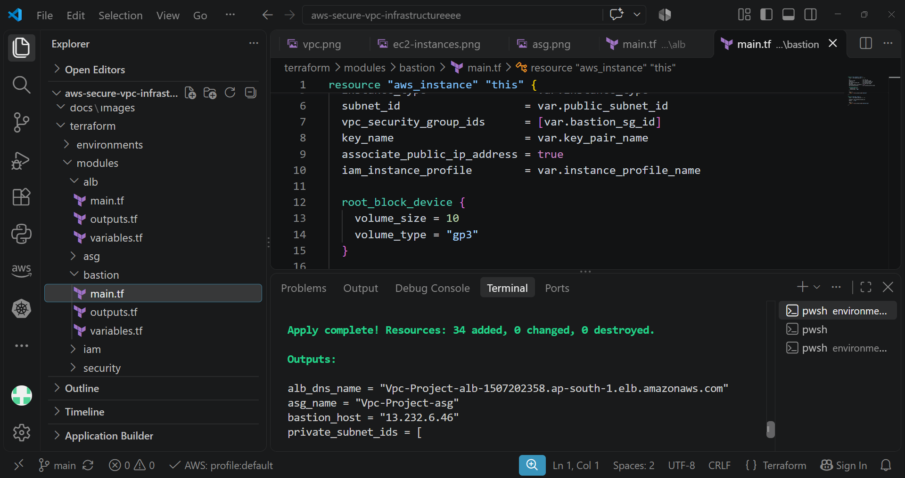
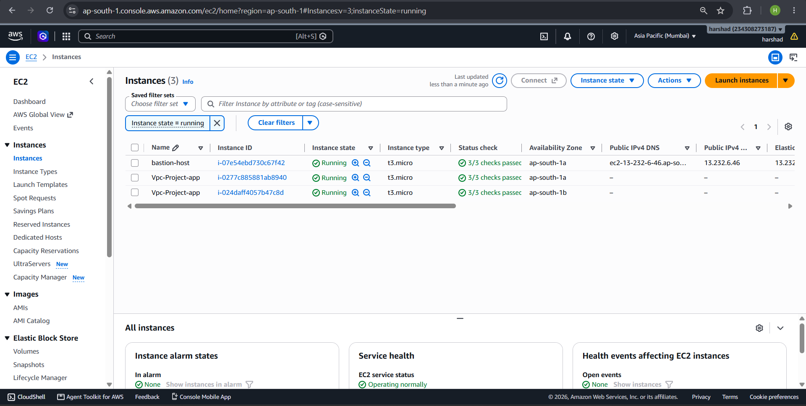
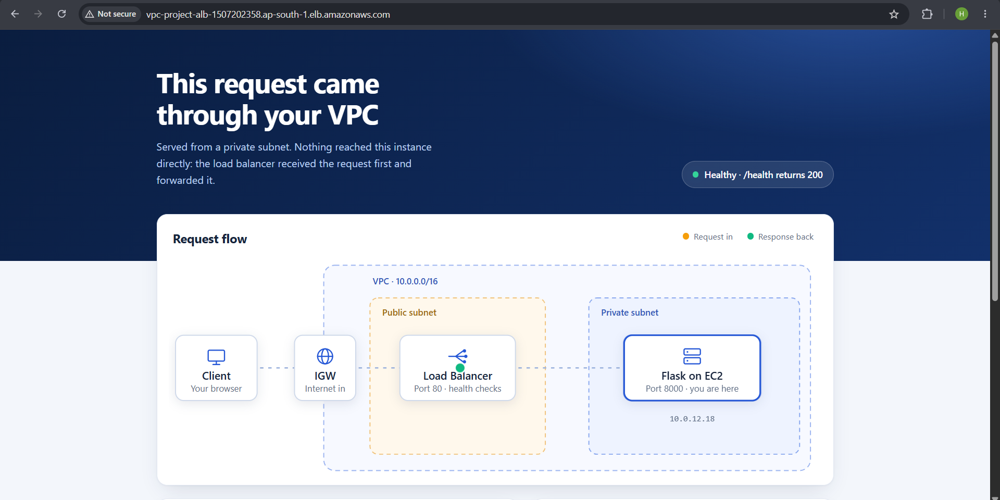
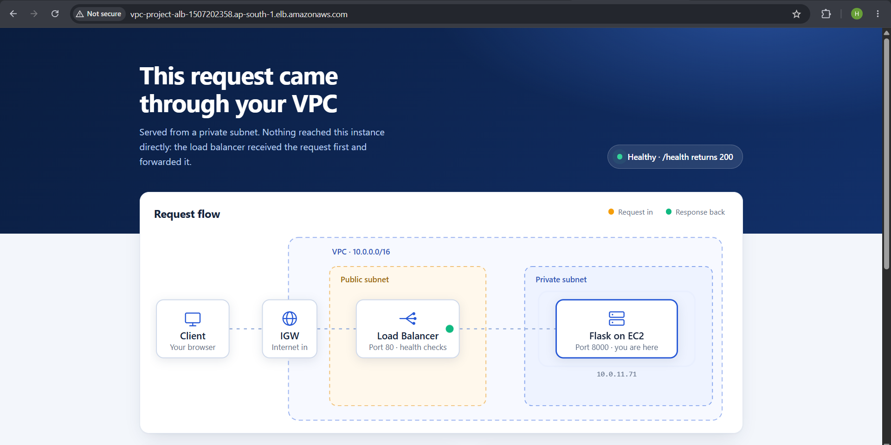

# AWS Secure VPC Infrastructure


A highly available, secure and scalable AWS network deployed in **Asia Pacific (Mumbai) – `ap-south-1`** and provisioned entirely with **Terraform**. A Flask application runs on EC2 instances in private subnets behind an internet-facing Application Load Balancer, with administrative access through a bastion host.

---

## Architecture Overview

| Component | Details |
|---|---|
| **VPC** | `Vpc-Project` – `10.0.0.0/16`, DNS hostnames and DNS resolution enabled |
| **Availability Zones** | `ap-south-1a`, `ap-south-1b` |
| **Public Subnets** | `10.0.1.0/24` (AZ-A), `10.0.2.0/24` (AZ-B) |
| **Private Subnets** | `10.0.11.0/24` (AZ-A), `10.0.12.0/24` (AZ-B) |
| **Internet Gateway** | `Vpc-Project-igw` – public internet access for the VPC |
| **NAT Gateways** | `Vpc-Project-nat-ap-south-1a` and `-1b` – one per AZ, each with an Elastic IP, for outbound-only internet from private subnets |
| **Route Tables** | 1 public (→ IGW) and 1 private per AZ (→ NAT Gateway in the same AZ) |
| **Application Load Balancer** | `Vpc-Project-alb` – internet-facing, HTTP:80, in both public subnets |
| **Target Group** | `Vpc-Project-tg` – HTTP:8000, health check on `/health` |
| **Auto Scaling Group** | `Vpc-Project-asg` – desired 2, min 2, max 4, launched from a launch template |
| **EC2 Instances** | `t3.micro` application instances (`Vpc-Project-app`) in the private subnets, no public IP |
| **Bastion Host** | `bastion-host` in a public subnet for SSH administration |

### Traffic Flow

1. A client sends an HTTP request to the ALB DNS name through the **Internet Gateway**.
2. The **ALB** (public subnets) forwards the request to the **Target Group**.
3. The Target Group routes it to a healthy **EC2 instance in a private subnet** on port 8000.
4. Instances reach the internet for updates and packages through the **NAT Gateway** in their own AZ (outbound only).
5. Admins SSH to the **bastion host**, then hop to the private instances.

### Key Benefits

- High availability across two AZs, including one NAT Gateway per AZ
- Application instances are never exposed directly to the internet
- Scales automatically between 2 and 4 instances with Auto Scaling
- Controlled admin access through a bastion host
- Fully reproducible with Terraform modules

---

## Project Structure

```
aws-secure-vpc-infrastructure/
├── docs/
│   └── images/              # Architecture diagram & deployment screenshots
├── terraform/
│   ├── environments/        # Environment configurations (run Terraform from here)
│   ├── modules/
│   │   ├── alb/             # Application Load Balancer, listener, target group
│   │   ├── asg/             # Launch template and Auto Scaling Group
│   │   ├── bastion/         # Bastion host EC2 instance
│   │   ├── iam/             # IAM instance profile for EC2
│   │   └── security/        # Security groups
│   └── user_data.sh         # Bootstrap script that installs and starts the Flask app
├── .gitignore
└── README.md
```

---

## Prerequisites

- An AWS account with permissions to create VPC, EC2, ELB, Auto Scaling and IAM resources
- [Terraform](https://developer.hashicorp.com/terraform/downloads) installed
- [AWS CLI](https://aws.amazon.com/cli/) installed and configured (`aws configure`)
- An existing EC2 key pair in `ap-south-1` for SSH access to the bastion host

---

## How to Deploy

```bash
# 1. Clone the repository
git clone https://github.com/harshad-09/aws-secure-vpc-infrastructure.git
cd aws-secure-vpc-infrastructure/terraform/environments/<environment>

# 2. Create your variable file from the example and edit the values
cp terraform.tfvars.example terraform.tfvars

# 3. Initialise, review and apply
terraform init
terraform plan
terraform apply
```

When `apply` finishes, Terraform prints the outputs: `alb_dns_name`, `asg_name`, `bastion_host` and `private_subnet_ids`. Open the ALB DNS name in a browser to see the running application.

---

## Deployment Screenshots

### 1. Terraform Apply
`terraform apply` completed with **34 resources added, 0 changed, 0 destroyed**, and printed the ALB DNS name, ASG name, bastion host address and private subnet IDs.



### 2. VPC Resource Map
`Vpc-Project` (`10.0.0.0/16`) with 4 subnets across two AZs, 4 route tables, and 3 network connections: the internet gateway and one NAT gateway per AZ.


### 3. EC2 Instances
Three instances are running with all status checks passed: the `bastion-host` (public subnet, public IPv4) and two `Vpc-Project-app` instances spread across `ap-south-1a` and `ap-south-1b` with no public IP.



### 4. Application Load Balancer
`Vpc-Project-alb` is **Active** and internet-facing, spanning two Availability Zones, with an HTTP:80 listener forwarding 100% of traffic to the `Vpc-Project-tg` target group.


### 5. Load Balancer Resource Map
The listener, rule, target group and both targets (port 8000) are connected, and both targets are **Healthy**.


### 6. Target Group
`Vpc-Project-tg` (HTTP:8000) has 2 registered targets, one in `ap-south-1a` and one in `ap-south-1b`: 2 healthy, 0 unhealthy.


### 7. Auto Scaling Group
`Vpc-Project-asg` is **At desired capacity** (desired 2, scaling limits 2–4) and uses a launch template with a `t3.micro` instance type.


### 8. Running Application – Load Balancing Across AZs
The application is reachable through the ALB DNS name. Each page confirms the request was served from a **private subnet**, after passing through the Internet Gateway and the load balancer, and shows the `/health` endpoint returning `200`.

Refreshing the page shows requests being served by instances in **both** Availability Zones:

| Request served by | Private IP | Subnet |
|---|---|---|
| Instance in AZ-A | `10.0.11.71` | `10.0.11.0/24` |
| Instance in AZ-B | `10.0.12.18` | `10.0.12.0/24` |





---

## Verify It Yourself

```bash
# Hit the load balancer (run it several times and watch the private IP change)
curl http://<alb-dns-name>

# Health check endpoint used by the target group
curl http://<alb-dns-name>/health
```

Replace `<alb-dns-name>` with the `alb_dns_name` Terraform output (for example `Vpc-Project-alb-xxxxxxxxxx.ap-south-1.elb.amazonaws.com`).

---

## Access Private Instances via Bastion Host

```bash
# Use SSH agent forwarding so the private key never has to be copied to the bastion
ssh-add <your-key>.pem
ssh -A ubuntu@<bastion-public-ip>

# From the bastion, connect to a private instance
ssh ubuntu@<private-instance-ip>
```

The default SSH user depends on the AMI (`ubuntu` for Ubuntu, `ec2-user` for Amazon Linux).

---

## Security Notes

- Application instances have **no public IP** and are only reachable through the ALB.
- Security groups are intended to allow app traffic only from the ALB, and SSH to the app instances only from the bastion host.
- Restrict the bastion host's SSH rule to **your own IP** instead of `0.0.0.0/0`.
- The ALB listener is HTTP only (demo setup). For production, add an HTTPS listener with an ACM certificate and redirect HTTP to HTTPS.
- Never commit `terraform.tfvars`, `*.pem` files or Terraform state files – keep them in `.gitignore`.

---

## Roadmap

- [ ] Amazon CloudWatch monitoring: alarms, dashboards and logs (shown in the architecture diagram, not yet deployed)
- [ ] HTTPS on the ALB with an ACM certificate
- [ ] CI/CD with GitHub Actions for zero-downtime deployments using ASG instance refresh

---

## Cleanup

NAT Gateways and the load balancer are billed hourly, so destroy the stack when you are done testing:

```bash
terraform destroy
```

---

## AWS Services Used

Amazon VPC · Amazon EC2 · Application Load Balancer · Target Groups · Auto Scaling Group · NAT Gateway · Internet Gateway · Bastion Host · Security Groups · IAM · Terraform