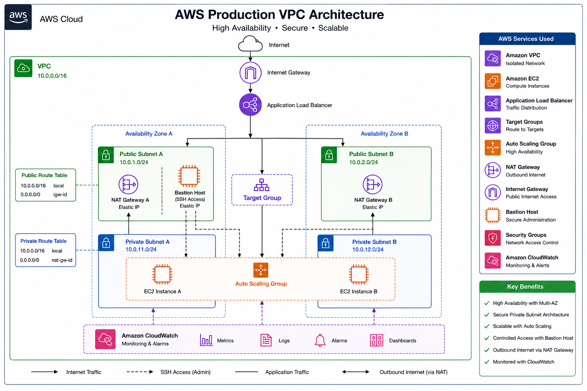
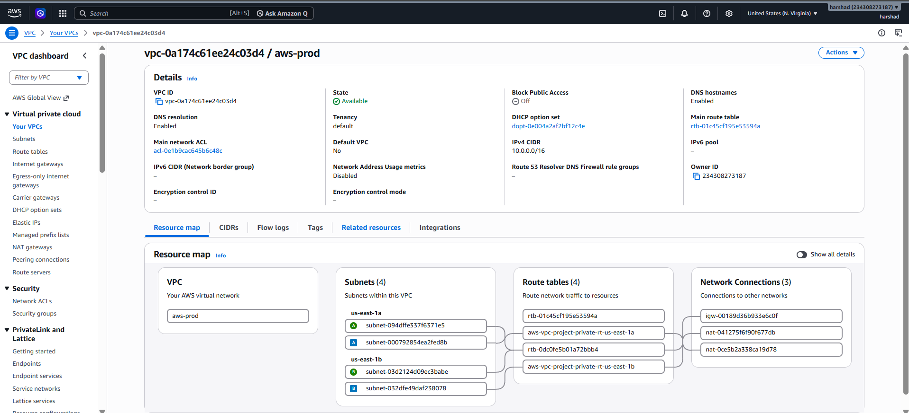
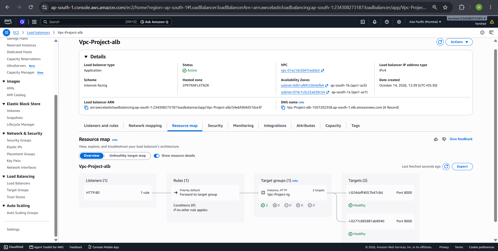
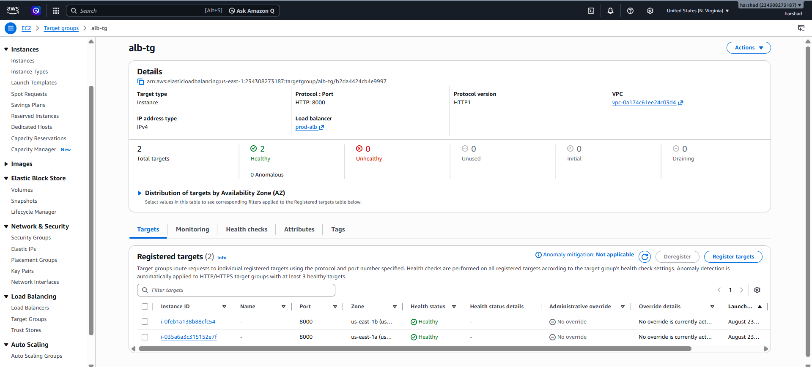
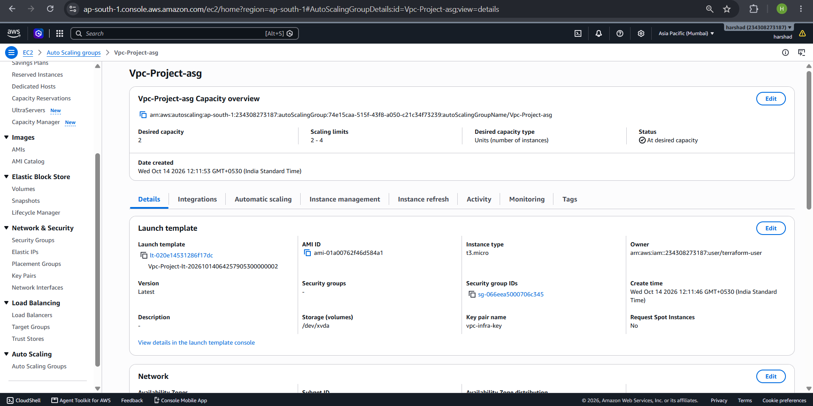
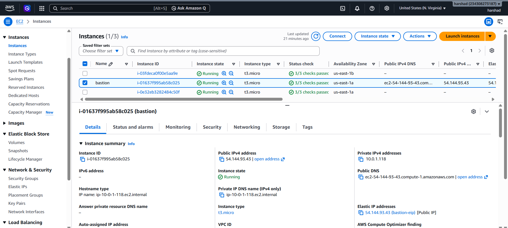

# AWS Secure VPC Infrastructure



## Project Overview

This project provisions a complete, production-shaped AWS environment from scratch — no console click-ops, no manual steps. It's built to demonstrate the core patterns behind a secure, highly-available network on AWS:

- Public and private subnets split across two Availability Zones
- Application traffic flows in through an ALB and never touches the internet directly at the instance level
- Administrative (SSH) access is only possible through a locked-down bastion host
- Compute scales automatically via an Auto Scaling Group, health-checked continuously by the ALB
- The whole environment is monitored with CloudWatch (metrics, logs, alarms, dashboards)
- Everything is defined as reusable Terraform modules, not one large flat configuration

## Key Features

- **High Availability** — resources are duplicated across two Availability Zones (subnets, NAT Gateways, EC2 instances), so a single AZ failure doesn't take the app down
- **Secure Private Subnet Architecture** — application EC2 instances have no public IP and are unreachable from the internet; all inbound app traffic must go through the ALB
- **Scalable Compute** — an Auto Scaling Group backed by a launch template scales instance count based on health and demand
- **Controlled Administrative Access** — a single bastion host, in a public subnet with its own security group, is the only SSH entry point into the private network
- **Outbound Internet via NAT** — private instances reach the internet (for updates, package installs) through per-AZ NAT Gateways, without being reachable *from* the internet
- **Least-Privilege IAM** — separate IAM roles/instance profiles for app instances and the bastion, scoped to only the permissions each needs (SSM, CloudWatch)
- **Full Observability** — Amazon CloudWatch collects metrics, logs, alarms, and dashboards across the environment
- **Modular Terraform** — every major component (VPC, security groups, IAM, ALB, ASG, bastion) is its own module with explicit inputs/outputs, so pieces can be reused or swapped independently

## Terraform Folder Structure

```
.
├── docs/images
│                      # Architecture diagram and screenshots
├── terraform/
│   ├── environments/
│   │   ├── main.tf                # Wires all modules together
│   │   ├── variables.tf           # Input variables
│   │   ├── outputs.tf             # Root-level outputs
│   │   ├── providers.tf           # AWS provider configuration
│   │   └── terraform.tfvars.example
│   ├── modules/
│   │   ├── vpc/                   # VPC, subnets, IGW, NAT gateways, route tables
│   │   ├── security-groups/       # ALB / app / bastion security groups
│   │   ├── iam/                   # Least-privilege instance roles and profiles
│   │   ├── alb/                   # Application Load Balancer, target group, listener
│   │   ├── asg/                   # Launch template + Auto Scaling Group
│   │   └── bastion/               # Bastion EC2 instance + Elastic IP
│   └── user_data.sh               # EC2 boot script (Flask app + CloudWatch Agent)
└── .gitignore
```

Each module accepts explicit input variables and returns explicit outputs — modules never reach into each other's resources directly. That's what makes them reusable on their own, and what makes the dependency graph easy to reason about as the project grows.

## Architecture Details

| Layer | Components |
|---|---|
| **Network** | VPC (`10.0.0.0/16`), 2 public + 2 private subnets across 2 AZs, Internet Gateway, per-AZ NAT Gateways |
| **Edge** | Internet-facing Application Load Balancer, HTTP listener, target group with health checks |
| **Compute** | Auto Scaling Group (launch template, min/desired/max capacity) running the app via systemd |
| **Admin access** | Bastion host in a public subnet with an Elastic IP, reachable only from an allow-listed CIDR |
| **IAM** | Separate least-privilege roles for app instances (SSM + CloudWatch) and the bastion (SSM) |
| **Monitoring** | CloudWatch Agent on every instance — metrics, logs, alarms, and dashboards |

**Traffic flow:** Internet → ALB (public subnets) → Target Group → EC2 instances (private subnets, no public IP)
**Admin flow:** Admin → Bastion Host (public subnet, Elastic IP) → EC2 instances (private subnets, SG-scoped SSH)

## Screenshots

**VPC** — subnets, route tables, and NAT/IGW connections across both AZs:



**Application Load Balancer** — listener, rules, and target group configuration:



**Target group** — app instances passing the `/health` check:



**Auto Scaling Group** — launch template and capacity configuration:



**Bastion host** — running instance with its Elastic IP for controlled SSH access:



**App running** — EC2 instance deployed in a private subnet, serving traffic through the ALB:


## Prerequisites

- Terraform >= 1.5.0
- AWS CLI configured with credentials that can create VPC/EC2/IAM/ELB resources
- An existing EC2 key pair

## Usage

```bash
cd terraform/environments
cp terraform.tfvars.example terraform.tfvars
# edit terraform.tfvars with your key pair name and allowed SSH CIDR

terraform init
terraform plan
terraform apply
```

Once applied, the app is reachable at the ALB DNS name shown in the `alb_dns_name` output.


